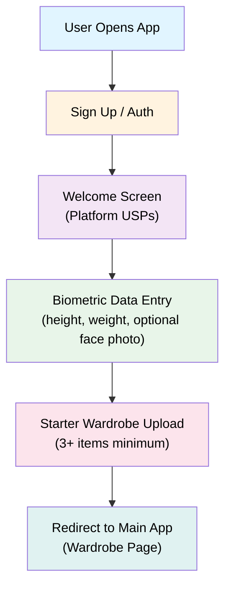

# Feature: Onboarding Flow

## Overview
New users sign up and go through a guided onboarding experience to establish their style profile, biometric data, and starter wardrobe. This is critical for populating the AI recommendation engine.

---

## User Flow



---

## Feature Breakdown

### 1. Sign Up / Authentication
**Purpose:** Create account and enable cloud sync + subscription tracking

**Flow:**
- Email/password signup OR OAuth (Google, Apple ID)
- Verify email
- Create password
- Set username (optional, for future social features)

**Data captured:**
- Email
- Password (hashed)
- Account creation date
- Trial start date (triggers 7-day countdown)

---

### 2. Welcome Screen (Platform USPs)
**Purpose:** Show value proposition and set expectations

**Design:**
- 3-4 carousel screens with key benefits:
  1. **"Find Your Signature Style"** - Discover what actually works for you by analyzing your wardrobe
  2. **"Build Your Target Style"** - Identify the pieces that matter, get clarity on what to buy next
  3. **"Visualize Your Fits"** - See how outfits look on your body with AI-powered fit generation
  4. **"Show Off Your Style"** - Showcase your curated wardrobe with friends and get inspired

- CTA: "Next" or "Let's Get Started"
- Each screen has simple illustration/icon
- Skip option (but encourage completion)

---

### 3. Biometric Data Entry
**Purpose:** Capture user body data for fit simulation on Fit page

**Required fields:**
- **Height** - Dropdown (cm/feet+inches toggle)
- **Weight** - Input field (kg/lbs toggle)

**Optional field:**
- **Face photo** - Upload or camera capture
  - Explained: "Helps us visualize outfits on your body (improves AI later)"
  - Privacy note: "Only you can see this. Never shared."
  - Can skip, but explain future benefit

**Validation:**
- Height: 130-220cm
- Weight: 30-200kg
- Face photo: Max 5MB, JPEG/PNG

**Data stored:**
- Height (cm)
- Weight (kg)
- Face photo (encrypted, stored separately)

---

### 4. Starter Wardrobe Upload
**Purpose:** Populate initial wardrobe with enough pieces for AI to analyze and generate accurate fit simulations

**Requirements:**
- **Minimum:** 3 items total (system enforces)
- Users can add more items at any time post-onboarding

**Upload flow per item:**
1. Take photo or upload from gallery
2. AI pre-fills: Category (shirt, pants, jacket, etc.), Color, Silhouette, Texture
3. User can edit/confirm tags
4. Add optional: Brand, material, notes
5. Save to wardrobe
6. "Add another item" or "Done"

**What AI should detect (visual semantics):**
- **Category:** Shirt, pants, jacket, hoodie, sweater, shoes, accessories, etc.
- **Color:** Primary color(s) and undertones
- **Silhouette:** Oversized, fitted, baggy, structured, loose, etc.
- **Texture/Fabric:** Cotton, wool, silk, denim, knit, etc.
- Any other useful visual attributes for accurate fit generation

**Edge cases:**
- Blurry photo: "Please take a clearer photo"
- Can't detect item: "Tag this manually: [dropdown]"
- User uploads < 3 items: Show "You have X items. Add more to improve fit accuracy" (non-blocking)

---

### 5. Redirect to Main App
**Purpose:** Seamless transition into core experience

**Actions:**
- Show "Setup complete!" message
- Redirect to Wardrobe page (show starter items)
- OR redirect to Fit page (show preview of avatar with starter pieces)
- Show tutorial tooltip on first interaction

---

## Technical Requirements

### Data Model
```
User {
  id: UUID
  email: string
  username: string (optional)
  passwordHash: string
  createdAt: timestamp
  trialStartDate: timestamp
  trialEndsAt: timestamp (trialStartDate + 7 days)
  subscriptionStatus: enum [trial, active, inactive, cancelled]
}

UserBiometrics {
  userId: UUID
  height: number (cm)
  weight: number (kg)
  facePhotoUrl: string (encrypted storage URL)
  updatedAt: timestamp
}

UserWardrobe {
  userId: UUID
  items: WardrobeItem[] (populated during onboarding)
  createdAt: timestamp
}
```

### API Endpoints
- `POST /auth/signup` - Create account
- `POST /auth/verify-email` - Email verification
- `POST /user/biometrics` - Save height, weight, face photo
- `POST /wardrobe/items` - Upload wardrobe item (batch)
- `GET /user/onboarding-status` - Check progress (for resume if user drops off)

### AI/ML Requirements
- **Image classification:** Detect clothing category (shirt, pants, etc.)
- **Visual semantics extraction:**
  - **Color:** Primary color(s) and undertones
  - **Silhouette:** Oversized, fitted, baggy, structured, loose, etc.
  - **Texture/Fabric:** Cotton, wool, silk, denim, knit, etc.
  - Other useful visual attributes for fit generation and styling
- **Face detection:** Validate face photo has a face (basic validation)

---

## Retention Hooks
- **Show immediate value:** After wardrobe upload, show preview on Fit page
- **Urgency:** Display "7-day trial" countdown timer
- **Progress:** Visual progress bar through onboarding steps
- **Social proof:** "X people have completed onboarding" (gamification)

---

## Edge Cases & Error Handling

| Scenario | Handling |
|----------|----------|
| User drops off mid-onboarding | Show "Resume onboarding" on login; save progress |
| Face photo upload fails | Allow skip, show note: "Improves AI later" |
| Can't reach 5 items | Show "You need X more items"; allow skip with warning |
| User wants to change styles | Confirm: "You can update this anytime on Style Board" |
| Biometric data is invalid | Show validation error + examples |
| Network error during upload | Queue for sync; show "Syncing..." indicator |

---

## Success Metrics
- **Completion rate:** % of users finishing onboarding
- **Avg time to complete:** Target < 5 minutes
- **Items uploaded:** Avg # of items added during onboarding
- **Trial-to-subscription conversion:** Track how many complete onboarding → convert
- **Fit generation quality:** User satisfaction with AI-generated fit previews on Fit page
