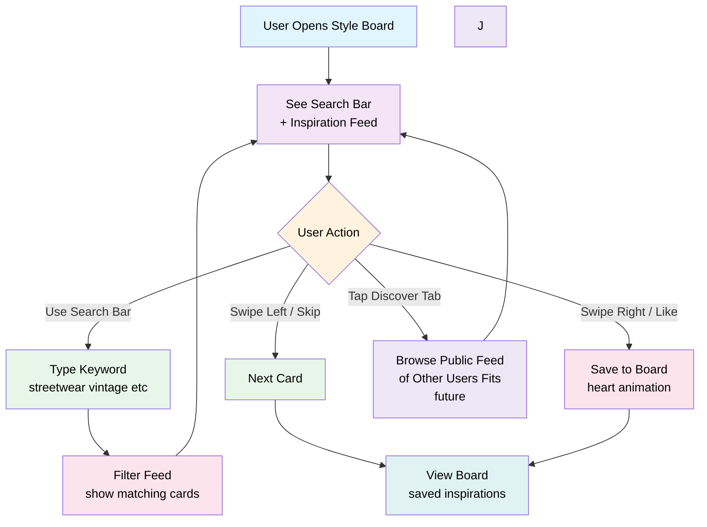

# Feature: Style Board

## Overview
A curated, swipe-based inspiration feed where users discover style references and save them to their personal mood collection. Works like a dating app (Tinder/Bumble style) with swipe mechanics. No user uploads—only curated/licensed content to maintain quality and avoid spam.

---

## User Flow



---

## Feature Breakdown

### 1. Main Feed - Swipe Interaction
**Purpose:** Discover and save style inspiration effortlessly

**Card UI:**
- Large image (full-screen or near full-screen)
- Style tag overlay (e.g., "Streetwear", "Minimalist", "Vintage")
- Card title: Optional (e.g., "Oversized Blazer Fit")
- Like count (optional, for social proof)

**Swipe Mechanics:**
- **Swipe right / Tap heart icon** → Save to Style Board
- **Swipe left / Tap X icon** → Skip (don't see again)
- **Tap image** → Expand to full view (optional detail screen)

**Card Deck:**
- Infinite scroll (continuously load new cards)
- Don't repeat cards (track seen inspirations per user)
- Prioritize by user's style selections (if user selected "Streetwear", show more streetwear)
- Weighted randomization (blend user preference with exploration)

---

### 2. Search & Filter
**Purpose:** Help users find specific style keywords

**Search Bar:**
- Text input at top of screen
- Placeholder: "Search streetwear, vintage, oversized..."
- Auto-suggestions: "Streetwear", "Vintage", "Y2K", "Minimalist", etc.

**Search Behavior:**
- Tag-based search (search by style category, aesthetic, keyword)
- Real-time results (show matching cards as you type)
- Can clear search → back to feed

**Example searches:**
- "streetwear"
- "oversized"
- "vintage band tee"
- "neutral palette"
- "smart casual"

---

### 3. Saved Style Board (Personal Collection)
**Purpose:** Curated inspiration collection for reference

**UI:**
- Grid view of saved inspirations (3 columns or 2 columns)
- Each card shows thumbnail + style tag
- Tap to expand/detail view
- Swipe/drag to reorder (optional, for curation)
- Delete button (X) to remove

**Features:**
- **Total saved:** Show count of saved styles ("You've saved 24 styles")
- **Organize by collection:** Option to create collections (e.g., "Streetwear Spring", "Vintage Finds")
  - (Future feature, MVP can be single collection)
- **Share collection:** Export as image or link (future feature)

---

### 4. Discover Tab (Public Outfit Feed)
**Purpose:** Browse public feed of outfits shared by other users (future feature)

**How it works:**
- Users can share their saved fits to the public "Discover" feed (from Fit page)
- Browse chronologically or filtered (trending, recent, most-liked)
- See avatar with outfit, outfit name/tags, like count
- Swipe-able feed similar to Style Board

**UI:**
- Shows outfit preview on avatar
- Username (optional, user can choose to hide)
- Outfit details (name, tags, # pieces)
- Like/save counter
- "Try this on" CTA (loads outfit into your Fit page to try)

**Privacy:**
- Public by default when shared (user explicitly shares)
- Users can anonymize their face (blur/block eyes) before sharing
- Can delete from feed anytime

---

## Technical Requirements

### Data Model
```
StyleCard {
  id: UUID
  imageUrl: string (curated content, hosted on platform)
  styleTagIds: UUID[] (references to StyleTag)
  title: string (optional)
  description: string (optional)
  source: string (credit/attribution)
  createdAt: timestamp
  likeCount: number (engagement metric)
}

StyleTag {
  id: UUID
  name: string (e.g., "Streetwear", "Minimalist")
  description: string
  category: enum [mainStyle, aesthetic, keyword]
}

UserStyleBoard {
  id: UUID
  userId: UUID
  title: string (default: "My Style Board")
  isPublic: boolean (default: false)
  savedStyles: StyleCard[] (array of saved card IDs)
  createdAt: timestamp
  updatedAt: timestamp
}

UserStyleInteraction {
  id: UUID
  userId: UUID
  styleCardId: UUID
  action: enum [like, skip]
  timestamp: timestamp
}

UserStyleCollection {
  id: UUID (future)
  userId: UUID
  name: string (e.g., "Streetwear Spring")
  styleCardIds: UUID[]
  createdAt: timestamp
}
```

### API Endpoints
- `GET /style-board/feed` - Get next cards for swipe feed (with pagination)
- `GET /style-board/feed?search=streetwear` - Search feed by keyword
- `POST /style-board/like` - Save inspiration to board
- `POST /style-board/skip` - Skip (track as seen)
- `GET /user/style-board` - Get user's saved styles
- `DELETE /user/style-board/:cardId` - Remove from board
- `GET /user/style-board/:userId` - View another user's public board (if public)
- `PUT /user/style-board/visibility` - Toggle public/private
- `GET /style-tags` - Get list of available tags

### Content Management
- **Curated sources:** Pinterest partnerships, fashion blogs, designer instagrams (licensed content)
- **No user uploads:** Keep content quality high, avoid spam/off-topic images
- **Content moderation:** Review submissions before adding to feed (if opening up later)
- **Image requirements:** Min 500x600px, JPEG/PNG, optimized for mobile

---

## Recommendation Engine Integration
**How Style Board feeds into AI:**
1. User's liked styles (style tags) inform recommendation weighting
2. Visual patterns in saved styles help AI understand user's color/silhouette preference
3. If user likes many "oversized streetwear" styles, AI prioritizes recommending oversized pieces
4. User can view their liked styles to refine recommendations

---

## Engagement Mechanics

| Hook | Purpose |
|------|---------|
| **Swipe animation** | Satisfying, addictive interaction |
| **Like count on cards** | Social proof (see what others like) |
| **Saved count badge** | Gamification (how many have you saved?) |
| **Trending styles section** | Discovery (what's trending this week) |
| **Share board to social** | Virality (show friends your curated styles) |

---

## Edge Cases & Error Handling

| Scenario | Handling |
|----------|----------|
| User runs out of cards | Show "You've seen all styles. Come back tomorrow for more!" |
| Search returns no results | Show "No styles match 'xyz'. Try searching 'streetwear'" |
| Slow network loading cards | Show skeleton loader, cache previous cards |
| User deletes saved style | Confirm delete; can undo within 5 seconds |
| Public board viewed by stranger | Show username + collection count + most-liked styles |

---

## Success Metrics
- **Engagement:** Avg # of cards swiped per session
- **Save rate:** % of cards liked vs. skipped
- **Return rate:** Users returning to Style Board weekly
- **Search usage:** % of users using search feature
- **Community discovery:** % of users viewing others' boards
- **Share rate:** % of users sharing board to social
