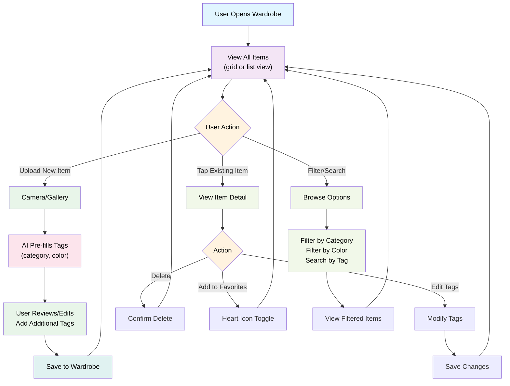

# Feature: Wardrobe Page

## Overview
User's personal clothing inventory. Upload, tag, organize, and manage all pieces in their wardrobe. AI auto-fills common tags (category, color) but users can edit/override. This is the single source of truth for all outfit recommendations and fit visualization.

---

## User Flow



---

## Feature Breakdown

### 1. Wardrobe Grid/List View
**Purpose:** Display all user's clothing items in organized, browsable format

**Header Controls:**
- **View toggle** (left): Switch between 2-column and 3-column grid view
- **Menu** (center): Additional options (sort, settings)
- **Filter button** (right): Open filter panel

**Category Section:**
- Category label (e.g., "SHIRT", "PANTS", "OUTER")
- Item count (e.g., "05") right-aligned
- Organized by category or currently filtered view

**View Options:**
- **2-Column Grid (default):** Full item card with all details
  - Thumbnail image (full width)
  - Brand name (gray, smaller text)
  - Item name/description (bold, larger)
  - Outfit count indicator: Bookmark icon + number (orange/brown color) showing how many of the user's saved outfits use this item
    - Example: "5 outfits" means this item is used in 5 complete saved outfits
  - Favorite indicator: Bookmark icon (when favorited)

- **3-Column Grid (compact):** Minimal details
  - Thumbnail image (full width)
  - Brand name only (gray, smaller text)
  - Outfit count indicator: Bookmark icon + number (same as 2-column)
  - NO item name/description displayed

- Toggle between views with button

**Filter Options:**
- **By Category:** Tops, Bottoms, Outer, Accessories, etc.
- **By Color:** Visual color palette (primary color filter)
- **By Style:** Streetwear, Goth, Minimalist, Oversized, etc. (separate detailed requirement pending)

**Sorting Options:**
- Recently added (default)
- Most worn (by outfit count)
- Category
- Color
- Brand
- Favorites first

---

### 2. Upload New Item
**Purpose:** Add clothing piece to wardrobe

**Upload Flow:**

**Step 1: Take/Upload Photo**
- Camera capture (live photo)
- OR gallery upload (existing photos)
- Show photo preview/crop tool
- Validation: Min 300x300px, max 10MB

**Step 2: AI Pre-fill Tags**
AI should detect and suggest:
- **Category** (required)
  - Detected options: Shirt, T-Shirt, Sweater, Hoodie, Jacket, Coat, Blazer, Pants, Jeans, Shorts, Skirt, Dress, Shoes, Accessories, etc.
  - Confidence score (if <70% confidence, ask user to confirm)
- **Primary Color** (required)
  - Detected options: Black, White, Gray, Red, Blue, Green, Yellow, Orange, Purple, Pink, Brown, Beige, Navy, etc.
- **Secondary Color** (optional)
  - If item has multiple colors

**Step 3: User Review & Edit**
- Display AI suggestions in edit form
- User can change/confirm each tag
- Add additional tags:
  - Material (cotton, polyester, wool, denim, silk, etc.)
  - Brand (text input or brand dropdown)
  - Fit (oversized, fitted, relaxed, baggy, slim, etc.)
  - Pattern (solid, striped, plaid, floral, graphic, etc.)
  - Occasion (casual, formal, workout, etc.)
  - Notes (e.g., "loose in shoulders", custom alteration details)

**Step 4: Save**
- Confirm save
- Show success message
- Option: "Add another item" or "View in wardrobe"

**AI Detection Requirements:**
- Should work for common clothing items
- Fallback to manual tag entry if AI is uncertain
- Learn from user corrections over time

---

### 3. Item Detail View
**Purpose:** View full item info, edit, delete, or favorite

**Display:**
- Large image (can pinch-zoom)
- All tags (category, color, material, brand, fit, pattern, occasion, custom notes)
- Metadata:
  - Date added
  - Last worn (if tracked)
  - Favorite status (heart icon)
- Action buttons: Edit, Delete, Add to Outfit (future)

**Edit Item:**
- Modify any tag
- Retake photo (replace image)
- Add/remove tags
- Save changes

**Delete Item:**
- Confirmation: "This item will be removed from your wardrobe. Remove outfits with this item?"
  - Option 1: Remove item only
  - Option 2: Remove item + all outfits containing it
  - Option 3: Keep item in outfits (item marked as archived/removed but stays in outfit history)

---

### 4. Filter & Search
**Purpose:** Quickly find items

**Filter Options:**
- **By Category:** Dropdown (Shirts, Pants, Jackets, Accessories, etc.)
- **By Color:** Color palette selector (tap color, highlight matching items)
- **By Brand:** Text search or brand list
- **By Material:** Checkboxes (Cotton, Polyester, Wool, etc.)
- **By Fit:** Oversized, Fitted, Relaxed, etc.
- **Favorites Only:** Toggle to show only liked items

**Search Bar:**
- Text search by any tag
- Example: "black oversized" → shows all black oversized items
- Real-time results

**Multi-filter:**
- Can combine filters (e.g., "Black pants" + "Fitted")
- Show active filters as chips at top
- Clear all filters button

---

### 5. Outfit Count Tracking
**Purpose:** Show how many saved outfits use each wardrobe item

**How It Works:**
- Each wardrobe item displays a count of how many complete saved outfits use that item
- Example: If user has 50 total saved outfits and an LV jacket is used in 5 of them, the jacket shows "5 outfits"
- Count updates dynamically when user creates/deletes outfits
- Helps users identify versatile pieces (high outfit count = highly used item)

**Display:**
- Bookmark icon + number next to item card
- Color: Orange/brown (#C67C4E or similar)
- Format: "📌 5 outfits" or similar

**Data Tracking:**
- System tracks which wardrobe items are used in each saved outfit
- Outfit structure: `{ headwear, base, outer, bottom, footwear }` (each can be an item ID or null)
- When displaying items, count how many saved outfits reference that item's ID

---

### 6. Favorites / Wardrobe Collections (Future)
**Purpose:** Organize wardrobe into sub-collections

**MVP Feature:**
- Favorite items (heart icon) for quick access
- "Favorite items" view

**Future Enhancement:**
- Create custom collections (e.g., "Winter Essentials", "Interview Outfits")
- Organize items into collections
- Share collections

---

## Technical Requirements

### Data Model
```
WardrobeItem {
  id: UUID or string
  userId: UUID (optional, for local prototype)
  imageUrl: string (primary photo)
  imageThumbnailUrl: string (optional, optimized)
  category: string (required, one of: tee, outer, pants, headwear, footwear, shorts, bag, scarf, collared-shirt)
  primaryColor: string (required)
  secondaryColor: string (optional)
  material: string[] (optional, cotton, polyester, etc.)
  brand: string (optional)
  fit: string (optional, from preset: tight, slim, standard, relaxed, oversize, other)
  pattern: string (optional)
  occasion: string[] (optional)
  customNotes: string (optional)
  isFavorite: boolean (default: false)
  createdAt: timestamp
  updatedAt: timestamp (optional)
  lastWornAt: timestamp (optional, for future tracking)
}

Outfit {
  id: UUID or string
  userId: UUID (optional, for local prototype)
  name: string (optional)
  items: {
    headwear?: string (item ID)
    base?: string (item ID)
    outer?: string (item ID)
    bottom?: string (item ID)
    footwear?: string (item ID)
  }
  tags: string[] (e.g., ["casual", "streetwear", "summer"])
  createdAt: timestamp
}

OutfitUsage {
  itemId: string
  outfitCount: number
  // Computed at display time by counting how many saved outfits reference this item
}

WardrobeTag {
  id: UUID (optional)
  name: string (category, color, material, style, etc.)
  type: enum [category, color, material, brand, fit, pattern, occasion, style]
  isPreset: boolean (AI can suggest preset tags)
}
```

### Frontend Functions (Local Storage)
- `wardrobeStorage.getAllItems()` - Get all items
- `wardrobeStorage.getItemsByCategory(category)` - Filter by category
- `wardrobeStorage.searchItems(query)` - Search items
- `wardrobeStorage.addItem(item)` - Add new item
- `wardrobeStorage.updateItem(id, updates)` - Update item
- `wardrobeStorage.deleteItem(id)` - Delete item
- `wardrobeStorage.toggleFavorite(id)` - Toggle favorite
- `outfitStorage.getAllOutfits()` - Get all saved outfits
- `outfitStorage.addOutfit(outfit)` - Create outfit
- `outfitStorage.deleteOutfit(id)` - Delete outfit

### Computed Functions
- `getOutfitCountForItem(itemId, outfits)` - Count how many outfits reference this item
  - Loop through all saved outfits
  - Check each outfit's items (headwear, base, outer, bottom, footwear)
  - Count matches where item ID equals provided itemId
  - Return count

### Filter Implementation
- **By Category:** Filter items where `category === selectedCategory`
- **By Color:** Filter items where `primaryColor === selectedColor`
- **By Style:** (Pending detailed requirement) Filter items based on style tags
- **Multiple Filters:** Combine filters with AND logic (item must match all selected filters)
- **Display Active Filters:** Show selected filters as removable chips above grid

### View State Management
**State variables:**
- `viewMode`: '2-column' | '3-column' (default: '2-column')
- `selectedFilters`: { category?: string, color?: string, style?: string[] }
- `sortBy`: 'recent' | 'most-worn' | 'category' | 'color' | 'brand' | 'favorites' (default: 'recent')
- `currentCategory`: string | null (for organizing display by category headers)

**Display Logic:**
1. Load all wardrobe items
2. Apply filters based on `selectedFilters`
3. Sort filtered items by `sortBy`
4. If organizing by category: group items by `category` and display category headers
5. Render grid with columns based on `viewMode` (2 or 3)
6. For each item: calculate outfit count using `getOutfitCountForItem(itemId, allOutfits)`
7. Display brand name, title (only if 2-column mode), outfit count, favorite status

### AI/ML Requirements
- **Image classification:** Detect clothing category with confidence score
- **Color detection:** Extract primary and secondary colors
- **Tagging suggestions:** Suggest fit, pattern, material (optional, low confidence ok)
- **Batch processing:** Handle multiple uploads efficiently

---

## Navigation Structure

**Bottom Navigation Tabs:**
1. **Try On** (star icon) - View items and try on outfits
2. **Saved Outfits** (bookmark icon) - View saved outfit combinations
3. **Wardrobe** (+ icon, center, active) - Main wardrobe inventory
4. **Styleboard** (grid icon) - Style inspiration and mood boards
5. (Account/Settings - may be in header or additional tab)

---

## UX Patterns

### Empty State
- User just signed up, no items yet
- Show illustration + "Add your first item" CTA
- Display onboarding hint: "Start by adding 5 items to get recommendations"

### Upload Confirmation
- Show uploaded photo + suggested tags
- "Looks good?" confirmation before saving
- Allows quick editing if tags are wrong

### Error Handling
- Photo too blurry: "Please take a clearer photo"
- AI can't detect: "What type of clothing is this?" → dropdown selector
- Upload fails: Retry button + offline queue

---

## Retention Hooks
- **Quick upload:** Camera is 1 tap away (home screen floating button)
- **Gamification:** "You've added X items" → milestone badges
- **Item suggestions:** "Based on your wardrobe, you're missing..." (recommendation preview)

---

## Success Metrics
- **Wardrobe growth:** Avg # of items added per user per week
- **Upload rate:** % of users actively uploading items
- **Filter usage:** % of users using filters/search
- **Favorite rate:** % of items marked as favorite
- **Engagement:** Avg time spent in Wardrobe page
