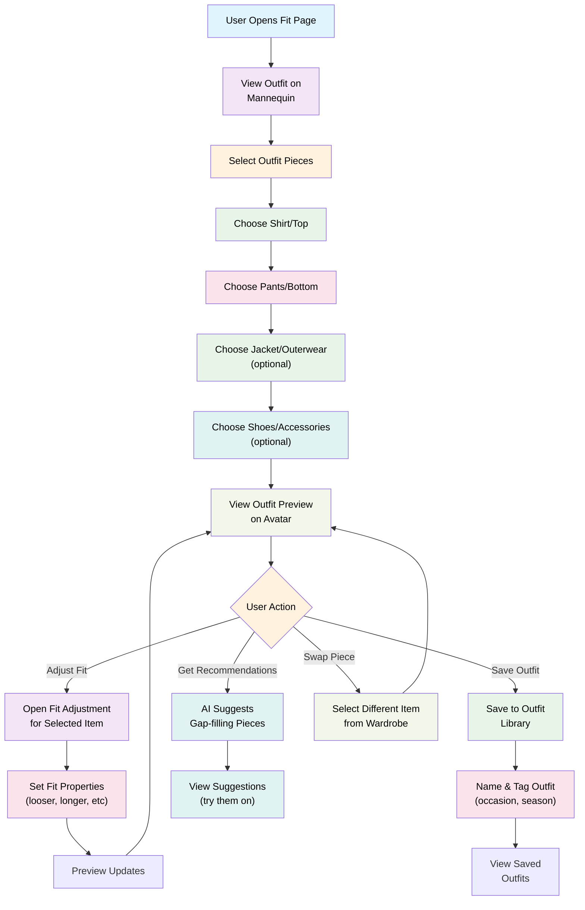

# Feature: Fit Page (Main App Homepage)

## Overview
The core "dress-up" experience. Users build and visualize outfits on a 3D avatar based on their biometric data (face, height, weight). This is where recommendations come to life and users test outfit combinations before shopping/wearing. Includes a "Fit Adjustment" feature to account for individual garment fit variations (looser, longer, tighter, etc.).

---

## User Flow



---

## Feature Breakdown

### 1. Outfit Display Model
**Purpose:** Visualize outfits on a simple model/mannequin with optional user face overlay

**Display Model:**
- **Default:** Simple mannequin (illustrated or 3D silhouette)
  - Generic, neutral-tone body (no biometric matching needed)
  - Focus is entirely on the clothing, not the model
- **User Face (Optional):** If user uploads a face photo during onboarding or in settings
  - Face is overlaid at head of mannequin
  - No body generation—just a simple head overlay on generic mannequin
  - If user doesn't upload a face, mannequin shows generic/blank head

**Why this approach:**
- Simpler to build (no 3D avatar generation, no biometric rendering)
- Faster rendering (generic model reused for all users)
- Focus stays on clothing visualization, not avatar realism
- Reduces liability/complexity of handling user face photos
- Fallback to mannequin ensures feature works for all users

**UI Placement:**
- Center of screen, large enough to see outfit details
- Portrait orientation (full-body view)
- Scrollable within screen bounds

**Lighting Options (Future Enhancement):**
- Optional: Toggle between lighting presets (daylight, outdoor, dark)
- Low priority for MVP—can add later if needed

---

### 2. Piece Selection (Outfit Builder)
**Purpose:** Easily select clothing pieces from wardrobe to build outfit

**UI Layout:**
- Avatar in center
- Bottom sheet / carousel of selectable categories
- OR side-by-side grid of category options

**Selection Flow:**

**Category: Top/Shirt**
- Show all tops from wardrobe (grid)
- Tap to apply to avatar
- Preview updates instantly
- Swipe/scroll through options quickly

**Category: Bottom/Pants**
- Show all bottoms from wardrobe
- Tap to apply
- Avatar updates to show shirt + pants combo

**Category: Outerwear (Optional)**
- Jackets, hoodies, coats, blazers
- Can be skipped
- Layered on top of top/bottom combo

**Category: Shoes (Optional)**
- Tap to add shoes
- Preview at bottom of avatar

**Category: Accessories (Optional)**
- Hats, bags, belts, jewelry
- Multiple accessories can be added

**Piece Card Display:**
- Thumbnail image
- Color swatch
- Item tags (category, color, fit)
- Star/favorite indicator (if user favorited)

---

### 3. Fit Adjustment Feature
**Purpose:** Account for individual garment fit variations (looser, longer, tighter, etc.)

**Problem:** Not all items fit the same way. A shirt tagged "oversized" might be looser on the shoulders but normal in length. Users need quick way to note actual fit so recommendations account for it.

**Suggested Name Options:**
- "Fit Notes"
- "Fit Adjustment"
- "Sizing Notes"
- "Fit Profile"
- "Item Fit"
- "My Fit" (if applied per item per user)

**Fit Adjustment UI:**

**Access:**
- Long-press or tap info icon on selected item in avatar view
- Or "Adjust fit" button in item detail panel

**Adjustment Options (Keep minimal—avoid granularity):**

| Fit Dimension | Options |
|---------------|---------|
| **Length** | Shorter than expected, True to size, Longer than expected |
| **Width/Fit** | Tighter than expected, True to size, Looser than expected |
| **Sleeve Length** (tops only) | Too short, True to size, Too long |
| **Rise** (pants only) | Low rise, Mid rise, High rise |

**Example Adjustments:**
- User has a shirt tagged "oversized" but it's actually snug in shoulders
  - Fit: "Tighter than expected" for width
- Jeans are longer than typical jeans
  - Fit: "Longer than expected" for length
- Jacket sleeves are short
  - Fit: "Too short" for sleeve length

**Data Capture:**
- Store fit notes per user-item combo (not global)
- Example: User A's "Oversized Shirt" is loose, User B's same shirt is snug
- Fit data helps personalize recommendations

**Visual Feedback:**
- When fit is adjusted, show slight avatar adjustment (avatar hunches if tight, straightens if loose)
- Not hyper-accurate, just visual hint
- Show "Fit note: Runs loose in shoulders" label on item

**Recommendation Impact:**
- If user adjusts "runs large", recommend similar items but smaller size (for future shopping)
- If user marks "runs small", suggest pieces that tend to fit true or large

---

### 4. Outfit Preview & Interaction
**Purpose:** See how outfit looks on avatar, iterate quickly

**Interaction:**
- Swipe avatar left/right to rotate view
- Tap to zoom in on details
- Pinch-zoom to inspect
- Tap pieces to edit/swap

**Feedback:**
- Show "Compatibility score" (optional):
  - ✓ Great combo (colors harmonize, proportions balance)
  - ≈ Good (acceptable, no major clashes)
  - ⚠ Questionable (might not work, but worth trying)
- OR show silhouette balance indicator (helpful for proportions)

**Share Outfit:**
- Screenshot/export outfit as image
- Share to social media (outfit post)
- Save to outfits library

---

### 5. Outfit Library & Sharing
**Purpose:** Track created outfits and share to public feed (future)

**Save Outfit Flow:**
- Tap "Save outfit" button
- Modal appears:
  - Optional name (e.g., "First Date", "Work Presentation")
  - Tags (occasion, season, weather, mood)
  - Optional notes (e.g., "paired with black shoes")
- Save → added to outfit library

**Outfit Library View:**
- Grid of saved outfits (thumbnail preview)
- Tap to re-load outfit on avatar
- Swipe to quick-action: Edit, Delete, Share to Feed, Rate
- Filter/sort by date, occasion, season

**Share to Public Feed:**
- User taps "Share to Feed" on saved outfit
- Option to anonymize face:
  - **Default:** Show full avatar with face
  - **Blur face:** Blur entire face area
  - **Block eyes:** Block/pixelate eyes only
- Choose whether to show username or stay anonymous
- Confirm and share to public Discover feed
- Can unshare/delete anytime

**Outfit Rating:**
- After wearing, user can rate outfit: Loved, Ok, Didn't work
- Helps AI learn what combinations user prefers
- Improves future recommendations

---

### 6. Recommendations Integration
**Purpose:** Show AI suggestions for gap-filling pieces

**"Get Recommendations" Button:**
- Visible on main Fit page
- Triggers AI to analyze current outfit/wardrobe
- Shows 3-5 suggestions per request

**Recommendation Display:**
- Show suggested piece (image + tags)
- Explain why: "You need more neutral bottoms to pair with this shirt"
- CTA: "Try it on" → applies suggestion to avatar
- CTA: "Add to wardrobe" (if user wants to shop for similar item—future feature)

**Recommendation Logic:**
- Gap-filling: What types of pieces are missing
- Outfit generation: New combinations with existing pieces
- Based on wardrobe analysis, style profile, and fit data

---

## Technical Requirements

### Data Model
```
UserFacePhoto {
  userId: UUID
  facePhotoUrl: string (optional, encrypted)
  uploadedAt: timestamp
  updatedAt: timestamp
}

UserFitPagePreferences {
  userId: UUID
  updatedAt: timestamp
}

SharedOutfit {
  id: UUID
  userId: UUID
  outfitId: UUID
  faceAnonymization: enum [none, blur_face, block_eyes] (default: none)
  showUsername: boolean (default: true)
  sharedAt: timestamp
  likes: number
  isPublished: boolean (default: true)
}

OutfitItem {
  id: UUID
  userId: UUID
  wardrobeItemId: UUID (reference to WardrobeItem)
  position: enum [top, bottom, outerwear, shoes, accessory]
  fitAdjustment: {
    length: enum [shorter, true, longer]
    width: enum [tighter, true, looser]
    sleeveLength: enum [short, true, long] (optional, if applicable)
    rise: enum [low, mid, high] (optional, if pants)
  }
  customNotes: string (optional)
  createdAt: timestamp
}

SavedOutfit {
  id: UUID
  userId: UUID
  name: string (optional)
  items: OutfitItem[] (top, bottom, outerwear, etc.)
  tags: string[] (occasion, season, weather, mood)
  notes: string (optional)
  photoUrl: string (screenshot of outfit on avatar)
  rating: enum [loved, ok, didnt-work] (optional)
  wornDate: timestamp (optional)
  createdAt: timestamp
  updatedAt: timestamp
}

OutfitFeedback {
  id: UUID
  userId: UUID
  outfitId: UUID
  rating: enum [loved, ok, didnt-work]
  notes: string (optional)
  timestamp: timestamp
}
```

### Mannequin Display System
**Approach:**
- Use a simple, generic mannequin (2D illustrated or 3D silhouette)
- Render clothing on the mannequin (no biometric customization)
- Optionally overlay user's uploaded face photo at the head (if provided)
- If user hasn't uploaded face, show blank/generic head on mannequin

**Implementation Options:**
1. **2D Illustrated mannequin** - Faster to build, easier to layer clothing
2. **3D silhouette** - More realistic feel, but requires 3D rendering
3. **Ready-made assets** - Use existing SVG/PNG mannequin templates

**Recommendation for MVP:** Start with simple 2D illustrated mannequin for speed

### API Endpoints
- `POST /user/face-photo` - Upload user face photo
- `GET /user/face-photo` - Retrieve user's uploaded face photo
- `DELETE /user/face-photo` - Delete user's face photo
- `POST /outfit/save` - Save outfit with items and tags
- `GET /outfit` - Get all saved outfits
- `GET /outfit/:id` - Get outfit detail
- `PUT /outfit/:id` - Update outfit (name, tags, rating)
- `DELETE /outfit/:id` - Delete outfit
- `POST /outfit/:id/rate` - Rate outfit (loved/ok/didnt-work)
- `GET /recommendations/outfit` - Get outfit recommendations based on current selection

### Avatar Rendering
- **Clothing layering:** Top → Bottom → Outerwear order for proper visual stacking
- **Color accuracy:** Render clothing in actual colors from wardrobe items
- **Fit visualization:** Adjust avatar posture/shape based on fit adjustments (subtle, not dramatic)
- **Performance:** Optimize rendering for mobile (smooth swipe/interaction)

---

## UX Patterns

### Empty State (No Saved Outfits)
- Show illustration + "Create your first outfit"
- Button: "Build outfit now"
- Show tips: "Try mixing oversized + fitted for balance"

### Quick Start
- Pre-load avatar with recommended starter outfit
- Allow instant editing

### Onboarding Tooltip
- First time opening: "Tap categories to build outfit"
- "Try adjusting fit to personalize"
- "Swipe to rotate avatar"

---

## Retention Hooks
- **Visual gratification:** Seeing outfit on realistic avatar is satisfying
- **Outfit gamification:** Track saved outfits, milestone badges
- **Recommendations:** Daily fresh suggestions to try
- **Sharing:** Outlet to social (viral mechanic)

---

## Success Metrics
- **Outfit creation rate:** Avg # of outfits created per user per week
- **Fit adjustment usage:** % of items with fit adjustments
- **Recommendation engagement:** % of users viewing recommendations
- **Outfit rating:** % of outfits rated (loved/ok/didn't work)
- **Time in app:** Avg time spent in Fit page
- **Repeat usage:** % of users returning to Fit page weekly
