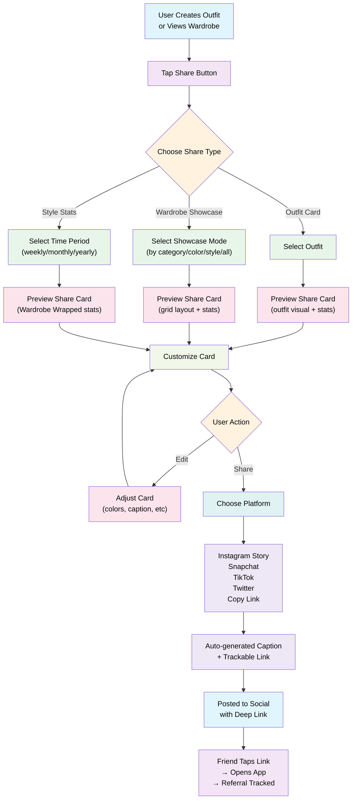

# Feature: Social Share Mechanism

## Overview
Users can create shareable social media cards for external platforms (Instagram Stories, Snapchat, TikTok, Twitter). Inspired by Strava's share activity feature, users generate beautiful, branded overlay cards showcasing their outfits, wardrobe collections, and style stats. Different from the internal "Share to Feed" feature (which shares fits to the public Discover feed within the app), this feature generates formatted cards optimized for external social platforms with auto-generated captions and trackable links for viral growth.

---

## User Flow



---

## Feature Breakdown

### 1. Share Types

Users can share three types of content:

#### A) **Outfit Card**
- **Triggered from:** Fit page (after creating outfit) or Outfit library
- **Card content:**
  - Large outfit preview (visual of pieces on avatar or grid layout)
  - Outfit name (if saved)
  - Style tags (occasion, season, vibe)
  - Personal quote or caption (optional, user can edit)
  - App logo/branding
  - "Open in app" CTA button or QR code

**Example Card Data:**
```
┌─────────────────────────────┐
│  [Slow Fashion App Logo]    │
│                             │
│      Outfit Preview         │
│     (pieces on avatar)      │
│                             │
│  "Going Out Tonight"        │
│  #Streetwear #OverSized     │
│                             │
│  👤 @username              │
│  Open in app →             │
└─────────────────────────────┘
```

#### B) **Wardrobe Showcase**
- **Triggered from:** Wardrobe page (after browsing)
- **Showcase modes (user selects one):**
  1. **By Category** - "All My Shirts", "All My Jackets", etc.
  2. **By Color** - "All My Blues", "Black Collection", etc.
  3. **By Style** - "Streetwear Essentials", "Minimalist Pieces", etc.
  4. **Entire Wardrobe** - All items in grid format

**Card content:**
  - Grid layout of items (6-12 items visible, neatly arranged)
  - Collection title (e.g., "All My Shirts" or "Streetwear Collection")
  - Item count (e.g., "23 pieces")
  - Personal note (optional, user-editable)
  - App branding
  - "Tap to see full wardrobe" CTA

**Example Card Data:**
```
┌──────────────────────────────┐
│   [Slow Fashion App Logo]    │
│                              │
│   🖼️ Grid of 12 items       │
│   (thumbnail previews)       │
│                              │
│   "All My Shirts"            │
│   23 pieces in collection    │
│   Built on [App Name]        │
│   View my full wardrobe →    │
└──────────────────────────────┘
```

#### C) **Style Stats (Wardrobe Wrapped)**
- **Triggered from:** Wardrobe analytics page (or home)
- **Triggered by:** User selects time period (this week, this month, this year)
- **Card content:**
  - Primary stat (e.g., "47 outfits created", "89 pieces worn")
  - Secondary metrics (color breakdown, most-worn piece, style consistency score)
  - Personal achievement highlight (e.g., "Most versatile piece: Black Oversized Blazer")
  - App branding
  - Personal message/caption

**Example Card Data:**
```
┌──────────────────────────────┐
│   [Slow Fashion App Logo]    │
│                              │
│      This Month              │
│      ━━━━━━━━━━━━━━━━━      │
│   47 unique outfits          │
│   23 pieces worn             │
│   Style: 85% Streetwear      │
│                              │
│   Most versatile piece:      │
│   🧥 Black Oversized Blazer  │
│                              │
│   Built on [App Name]        │
└──────────────────────────────┘
```

---

### 2. Card Customization

**User can customize before sharing:**
- **Caption text** - Edit pre-filled caption
- **Card colors** - Light/dark theme, custom color accent (optional)
- **Add emoji/stickers** - Standard emoji library
- **Add personal note** - Max 100 characters above or below main content
- **Show/hide specific elements** - Toggle item count, stats, etc.

**UI for customization:**
- Bottom sheet modal or overlay
- Real-time preview as user edits
- Quick preset options (light mode, dark mode, colorful)
- "Reset to default" button

---

### 3. Social Platform Integration

#### A) **Instagram Story**
- **Share flow:**
  1. User taps "Share to Instagram Story"
  2. App saves high-quality image (1080x1920px for story)
  3. Opens Instagram app with image in "Share" sheet
  4. Sticker/link overlay option (if Instagram allows)
  5. User adds text/tags/mentions
  6. Publishes to story

**Technical:**
- Generate image at Instagram story dimensions
- Include trackable link/QR code
- Auto-add hashtag (#MySlowFashion, #SlowFashionCommunity, etc.)

#### B) **Snapchat**
- **Share flow:**
  1. User taps "Share to Snapchat"
  2. App saves image optimized for Snapchat (1080x1920px)
  3. Opens Snapchat with image ready to share
  4. User can add text, filters, stickers
  5. Can send to friends or post to story

**Technical:**
- Snapchat Sharing API integration
- Image optimization for Snapchat dimensions
- Deep link to app (if user taps from Snapchat)

#### C) **TikTok**
- **Share flow:**
  1. User taps "Share to TikTok"
  2. App saves image/video clip (opt: short video preview of outfit or grid)
  3. Opens TikTok with content ready to post
  4. User adds music, text, effects
  5. Can choose draft or direct publish

**Technical:**
- TikTok Share API
- Optional: Generate short 3-5 second video (outfit spinning, grid animation)
- Deep link tracking

#### D) **Twitter/X**
- **Share flow:**
  1. User taps "Share to Twitter"
  2. App generates image + auto-caption
  3. Opens Twitter web intent with image + caption
  4. User can edit caption, add additional text
  5. Tweet published with trackable link

**Technical:**
- Twitter Share API / Web Intent
- Image + caption pre-filled
- Trackable URL with UTM parameters

#### E) **Copy Link / Share to Clipboard**
- **Share flow:**
  1. User taps "Copy Link"
  2. App generates shareable link (deep link to outfit/wardrobe in app)
  3. Link copied to clipboard
  4. User can paste in Messages, Discord, WhatsApp, etc.

**Technical:**
- Deep link format: `slowfashion://share/outfit/:outfitId` or similar
- QR code generation (optional, show on card preview)
- UTM tracking for analytics

---

### 4. Card Design & Branding

**Visual Design Principles:**
- **Clean, modern aesthetic** - Match app's visual identity
- **High contrast** - Ensure readability on all phone screens
- **Branded footer** - "Created with [App Name]" or logo
- **Customizable theme** - Light/dark/colorful modes
- **Responsive layout** - Works for all aspect ratios (Instagram, Snapchat, TikTok, Twitter)

**Card Elements:**
- **Header:** App logo/branding
- **Main content:** Outfit visual, wardrobe grid, or stats
- **Title/heading:** Outfit name, collection name, or stat headline
- **Metadata:** Item count, date, style tags, personal note
- **CTA:** "Open in App", "View Full Wardrobe", or app download link
- **Footer:** App name + hashtag (#MySlowFashion)

**Design specs:**
- Primary dimensions: 1080x1920px (Instagram Story standard)
- Alternative: 1200x628px (Twitter, Facebook)
- File formats: PNG (for transparency), JPG (for compressed sharing)
- Quality: High DPI (2x density) for crisp display on mobile

---

### 5. Auto-Generated Captions

**Caption templates vary by share type:**

**Outfit Card Captions:**
- "Wearing [outfit name] today 🎨 #SlowFashion #[StyleTag]"
- "Just created [outfit name]! Love this combo ✨ #[Occasion]"
- "Outfit inspo: [outfit name] [emoji] Check out my wardrobe in [App Name]"

**Wardrobe Showcase Captions:**
- "All my [category]! [count] pieces of [style] perfection 👕 #MySlowFashion"
- "My [category] collection is growing! [count] pieces, infinite combos ✨"
- "Flex: [count] [category] pieces in my wardrobe 🔥 Built on [App Name]"

**Style Stats Captions:**
- "I created [number] unique outfits this [period]! 🎨 My style: [color]% [style] #MySlowFashion"
- "This [period]: [stat1], [stat2], [stat3] ✨ Track your style on [App Name]"
- "Most worn piece: [item name] 👑 What's yours? #SlowFashion"

**Template system:**
- User can select from pre-written captions
- User can custom-edit any caption
- Auto-insert variables: [outfit name], [count], [style], [period], etc.

---

### 6. Trackable Links & Referrals

**Deep linking strategy:**
- Each share generates unique trackable link
- Format: `slowfashion.app/share?outfitId=abc123&referrer=instagram_story`
- Includes source tracking (instagram, snapchat, twitter, etc.)

**When friend clicks link:**
1. Opens app (or app store if not installed)
2. Deep link routes to shared outfit/wardrobe
3. "Shared by @username" attribution shown
4. CTA: "Join the app" / "Sign up to create outfits"
5. Referral tracked in analytics

**Referral benefits (future):**
- Track who referred new users
- Optional reward system (gamification feature)
- Social proof metrics ("3 friends shared this")

---

### 7. Share Analytics

**User can see (in app analytics page):**
- **Share count:** Total shares by type (outfit, wardrobe, stats)
- **Platform breakdown:** Which platforms most popular (Instagram, TikTok, etc.)
- **Engagement:** Clicks on shared links, new users from referrals
- **Top shared outfits:** Most-shared outfit cards
- **Trending content:** What resonates most with friends

**App-side analytics:**
- Track share events: outfit_shared, wardrobe_shared, stats_shared
- Platform source: instagram, snapchat, twitter, tiktok, link_copied
- Conversion funnel: share → click link → sign up / download

---

## Technical Requirements

### Data Model
```
ShareableContent {
  id: UUID
  userId: UUID
  contentType: enum [outfit, wardrobe_showcase, style_stats]

  # For outfit share
  outfitId: UUID (optional)

  # For wardrobe showcase
  showcaseMode: enum [by_category, by_color, by_style, all] (optional)

  # For style stats
  statsPeriod: enum [week, month, year] (optional)

  # Share card details
  cardTitle: string
  cardDescription: string (optional)
  customCaption: string (optional)
  cardTheme: enum [light, dark, colorful] (default: light)

  # Generated content
  cardImageUrl: string (1080x1920 primary)
  cardImageAltUrl: string (1200x628 for Twitter, optional)
  shareableLink: string (deep link with tracking params)

  # Analytics
  shareCount: number (incremented each share)
  platformBreakdown: {
    instagram: number
    snapchat: number
    twitter: number
    tiktok: number
    link_copy: number
  }
  clickCount: number (tracks link clicks)

  createdAt: timestamp
  expiresAt: timestamp (optional, auto-archive old shares)
}

ShareEvent {
  id: UUID
  userId: UUID
  shareableContentId: UUID
  platform: enum [instagram, snapchat, twitter, tiktok, clipboard]
  timestamp: timestamp
  deviceId: string (for tracking)
}

ShareClick {
  id: UUID
  shareableContentId: UUID
  platform: enum [instagram, snapchat, twitter, tiktok, other]
  timestamp: timestamp
  deviceId: string (anonymous, for tracking referral clicks)
  convertedToUser: boolean (did they sign up?)
}
```

### Image Generation

**Library/Tool Options:**
- **Canvas-based rendering** (Node.js/backend):
  - Use `canvas`, `fabric.js`, or `sharp` to generate images
  - Build on server, cache, serve to user
- **Client-side rendering** (React Native):
  - Use native drawing APIs (iOS: CoreGraphics, Android: Canvas)
  - Generate on device, faster but more complex
- **Template-based service** (Cloudinary, imgix):
  - Pre-design templates, dynamically insert data via API
  - Simplest approach

**Recommended:** Server-side canvas rendering (Node.js) for consistency and caching

**Image generation flow:**
1. User customizes card
2. Backend receives card data (caption, items, colors, etc.)
3. Canvas renders high-quality image (1080x1920px)
4. Image cached/stored in CDN
5. Returned to user for preview
6. User confirms and shares

### API Endpoints

```
POST /share/outfit/:outfitId/card
  - Generate shareable card for outfit
  - Request: { caption, theme, customizations }
  - Response: { cardImageUrl, shareableLink, cardPreview }

POST /share/wardrobe/card
  - Generate shareable card for wardrobe showcase
  - Request: { showcaseMode, caption, theme }
  - Response: { cardImageUrl, shareableLink, cardPreview }

POST /share/stats/card
  - Generate shareable card for style stats
  - Request: { period, caption, theme }
  - Response: { cardImageUrl, shareableLink, cardPreview }

POST /share/:shareableContentId/track
  - Track share event when user shares to platform
  - Request: { platform: 'instagram' | 'snapchat' | 'twitter' | 'tiktok' | 'clipboard' }
  - Response: { success, shareUrl }

GET /share/:shareableContentId
  - Get shared content details (for deep link)
  - Response: { outfit, wardrobe, stats, sharedBy, sharedAt }

POST /share/click
  - Track when someone clicks shared link
  - Request: { shareableContentId, platform, deviceId }
  - Response: { redirectUrl }

GET /user/shares/analytics
  - Get share analytics dashboard
  - Response: { shareCount, platformBreakdown, topShares, clickStats }
```

### Social Platform OAuth & Permissions

**Instagram:**
- No OAuth needed for story share (uses native share intent)
- Optional: Instagram Graph API for analytics (future)

**Snapchat:**
- Snapchat Kit integration (if available)
- Share to Stories capability
- Optional: Snapchat Ads API for tracking

**Twitter:**
- Twitter Web Intent (no OAuth needed)
- URL scheme: `https://twitter.com/intent/tweet?text=[caption]&url=[link]`

**TikTok:**
- TikTok Share API (if available)
- Fallback: Copy to clipboard + manual share

**Facebook/Messenger:**
- Share dialog via Facebook SDK
- Optional future integration

---

## UX Patterns

### Share Flow (Streamlined)
1. **User action:** Tap share button (outfit, wardrobe, or stats page)
2. **Share type selection:** Choose outfit/wardrobe/stats (if not obvious)
3. **Card preview:** Show how card looks before sharing
4. **Customize (optional):** Edit caption, theme, etc.
5. **Platform selection:** Choose Instagram Story, Snapchat, Twitter, etc.
6. **Publish:** Card generated, shared to platform
7. **Success:** "Shared to [platform]! Invite friends to see your style" with link to share again

### Empty State
- "No shared outfits yet! Create one and share to inspire friends"
- Quick CTA: "Create outfit" or "Explore wardrobe"

### Share Preview
- Full-screen preview before platform selection
- Swipeable carousel if multiple card versions available
- Edit button → customize → re-preview

---

## Retention & Virality Hooks

| Hook | Purpose |
|------|---------|
| **Trackable links** | See how many friends click your share (social proof) |
| **Share stats** | Dashboard showing shares/clicks/referrals (gamification) |
| **Branded overlay** | App visibility on social media (awareness) |
| **Auto-caption** | Low friction, encourages sharing (friction reduction) |
| **Referral tracking** | Know who you invited (social graph building) |
| **Share milestone badges** | "You've shared 10 times!" (gamification) |
| **Friend activity** | "Your friends created 5 outfits" (FOMO) |

---

## Edge Cases & Error Handling

| Scenario | Handling |
|----------|----------|
| Share link expires | Show "This share link has expired. Create a new one!" |
| Image generation fails | Fallback to simple text share + link to app |
| Platform app not installed | Offer: "Instagram app not found. Copy link instead?" |
| Network error during share | Queue share, retry on reconnect, notify user |
| Custom caption too long | Truncate with ellipsis, show char count warning |
| User has 0 outfits to share | Show "Create an outfit first!" with CTA |

---

## Success Metrics

- **Share rate:** % of created outfits/stats that get shared
- **Platform distribution:** Which platforms most popular (Instagram, TikTok, etc.)
- **Share frequency:** Avg # of shares per user per week
- **Referral conversion:** % of link clicks → new app downloads
- **Viral coefficient:** # of new users per 1 share (indicates virality)
- **Share engagement:** Avg time before user shares (how eager are they?)
- **Content resonance:** Which outfit/stat types get shared most
- **Repeat sharing:** % of users who share multiple times

---

## Future Enhancements

- **Video shares:** Short video of outfit (avatar spinning, grid animating)
- **AR try-on link:** Share with AR preview for friends to try outfit
- **Collaborative boards:** Share with specific friends for feedback
- **Influencer integration:** Partner creators can share from app
- **Share rewards:** Incentivize sharing (bonus trial days, premium features)
- **Trending dashboard:** See what's trending in community (weekly, daily)
- **Seasonal share campaigns:** "Winter Wardrobe Challenge" hashtag campaigns
